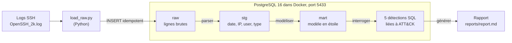

# ssh-sentinel

**Un pipeline de données qui ingère des logs d'authentification SSH dans PostgreSQL et y détecte les attaques : brute force, password spraying et compromission de compte.**

> Projet personnel.
> Statut : **en cours**. Ingestion brute terminée ; parser, modélisation et détections à venir.

---

## Pourquoi ce projet

Un SOC (Security Operations Center) reçoit des millions d'événements par jour. Avant de pouvoir repérer une attaque, il faut que ces événements soient **collectés, structurés et fiables**. Un SOC est donc d'abord un problème de données.

ssh-sentinel réunit les deux métiers sur un cas concret :

| Côté Data Engineering | Côté SOC |
| --- | --- |
| Ingestion de fichiers bruts | Lecture et compréhension des logs d'authentification |
| Modélisation en couches (`raw`, `stg`, `mart`) | Règles de détection écrites en SQL |
| Chargement idempotent, sans doublons | Rattachement des règles à MITRE ATT&CK |
| Reproductibilité avec Docker | Analyse et tri des alertes |

---

## Architecture



| Couche | Rôle | État |
| --- | --- | --- |
| `raw` | Copie exacte de chaque ligne du fichier, jamais modifiée | Fait |
| `stg` | Ligne découpée et typée : horodatage, IP, utilisateur, type d'événement | À venir |
| `mart` | Modèle en étoile : `fact_auth_event`, `dim_ip`, `dim_user` | À venir |
| Détections | Vues SQL qui produisent les alertes | À venir |

---

## Données

Le jeu de données est le fichier **OpenSSH** de [Loghub](https://github.com/logpai/loghub), de vrais logs d'un serveur SSH exposé à Internet : **2000 lignes**.

Exemple de lignes :

```
Dec 10 06:55:46 LabSZ sshd[24200]: Invalid user webmaster from 173.234.31.186
Dec 10 09:32:20 LabSZ sshd[24680]: Accepted password for fztu from 119.137.62.142 port 49116 ssh2
```

Les données ne sont pas versionnées (`data/` est dans `.gitignore`) : voir [Lancer le projet](#lancer-le-projet) pour les télécharger.

---

## Analyse exploratoire

Avant d'écrire du code, j'ai analysé les logs à la main avec les outils Unix (`grep`, `cut`, `sort`, `uniq`), comme le ferait un analyste SOC face à un nouveau jeu de données.

### 1. Une seule connexion réussie

```bash
grep -c "Accepted password" data/raw/OpenSSH_2k.log
# 1
```

Une seule connexion acceptée sur 2000 lignes, face à des centaines d'échecs : le serveur subit des tentatives de connexion massives.

**Cette connexion est-elle suspecte ?** L'IP `119.137.62.142` n'a **aucun** échec de mot de passe dans le fichier. On voit seulement la connexion de l'utilisateur `fztu` à 09:32:20, puis une déconnexion normale (`disconnected by user`) à 09:45:06. Rien n'indique une compromission dans ces données.

Limite : l'absence d'échecs ne prouve pas la légitimité. Un attaquant possédant un mot de passe volé réussirait du premier coup. La détection D3 vise justement l'inverse : une connexion réussie **précédée** de nombreux échecs depuis la même IP.

### 2. Les IP les plus agressives

```bash
grep "Failed password" data/raw/OpenSSH_2k.log \
  | grep -oE "from [0-9.]+" | cut -d' ' -f2 \
  | sort | uniq -c | sort -rn | head -5
```

| Rang | IP source | Échecs de mot de passe |
| --- | --- | --- |
| 1 | 183.62.140.253 | 286 |
| 2 | 187.141.143.180 | 80 |
| 3 | 103.99.0.122 | 46 |
| 4 | 112.95.230.3 | 26 |
| 5 | 5.188.10.180 | 18 |

- **520** échecs de mot de passe au total, venant de **23** IP différentes.
- La première IP en génère **55 %** à elle seule, les deux premières environ 70 %.
- Quelques sources concentrent l'essentiel des tentatives : c'est la signature d'un **brute force** (MITRE ATT&CK T1110).

### 3. Les types de messages, et la leçon pour le parser

```bash
cut -d: -f4- data/raw/OpenSSH_2k.log | cut -c1-40 | sort | uniq -c | sort -rn | head -5
```

| Occurrences | Début du message |
| --- | --- |
| 494 | `pam_unix(sshd:auth): authentication fai...` |
| 285 | `Received disconnect from 183.62.140.253` |
| 276 | `Failed password for root from 183.62.14...` |
| 135 | `pam_unix(sshd:auth): check pass; user u...` |
| 85 | `reverse mapping checking getaddrinfo fo...` |

Ce que ce résultat apprend :

- **Une tentative produit plusieurs lignes** : SSH écrit `Failed password`, le module système PAM écrit `authentication failure`. Compter des lignes n'est pas compter des attaques.
- **Couper le texte à longueur fixe est trompeur** : la coupure à 40 caractères tronque les IP et fusionne des sources différentes (`183.62.14...`), tandis que les parties variables (IP, utilisateur, port) séparent des événements du même type.

**Conclusion :** il faut extraire chaque champ séparément avec des expressions régulières. C'est le rôle du parser (étape suivante).

---

## Choix techniques

| Choix | Pourquoi |
| --- | --- |
| **PostgreSQL** | Base relationnelle robuste, fonctions de fenêtrage (`OVER ... RANGE INTERVAL`) idéales pour détecter « N échecs en 5 minutes ». |
| **Docker Compose** | Toute la base se lance en une commande, sans rien installer, de façon identique sur n'importe quelle machine. |
| **Trois couches `raw`, `stg`, `mart`** | `raw` conserve la donnée d'origine intacte : si le parser a un bug, on le corrige et on rejoue le traitement sans recharger les fichiers. |
| **Chargement et parsing séparés** | `load_raw.py` copie sans interpréter, `parser.py` interprète. Une responsabilité par fichier, donc plus simple à tester et à corriger. |
| **Requêtes paramétrées (`%s`)** | Les valeurs ne sont jamais collées dans le SQL : protection contre l'injection SQL. |

---

## Problèmes rencontrés et solutions

| Problème | Cause | Solution |
| --- | --- | --- |
| `services.ports must be a mapping` | Indentation YAML incorrecte dans `docker-compose.yml` | Réindentation : `ports` et `volumes` au même niveau que `image` |
| `failed to bind host port 0.0.0.0:5432: address already in use` | Un PostgreSQL local occupait déjà le port 5432 | Exposition du conteneur sur le port **5433** (`"5433:5432"`) |
| Conteneur arrêté aussitôt, `Permission denied` sur `/docker-entrypoint-initdb.d/` | **SELinux** (Fedora) interdit au conteneur de lire le dossier monté | Suffixe `:Z` sur le volume : `./sql:/docker-entrypoint-initdb.d:Z` |
| Une deuxième exécution du chargement donnait **4000** lignes au lieu de 2000 | Aucune règle n'empêchait d'insérer deux fois la même ligne | Chargement **idempotent** (voir ci-dessous) |

### Le chargement idempotent

Un script idempotent peut être relancé autant de fois qu'on veut : le résultat est le même qu'après une seule exécution. Sans cela, chaque ligne serait comptée deux fois et toutes les détections seraient faussées (une IP aurait deux fois plus d'échecs).

Deux mécanismes combinés :

1. Une **contrainte d'unicité** sur le couple (fichier, numéro de ligne) :
   ```sql
   CONSTRAINT auth_lines_uniq UNIQUE (source_file, line_no)
   ```
2. Une insertion qui **ignore** les lignes déjà présentes :
   ```sql
   INSERT INTO raw.auth_lines (line_no, line, source_file)
   VALUES (%s, %s, %s)
   ON CONFLICT (source_file, line_no) DO NOTHING
   ```

Résultat attendu : la première exécution insère 2000 lignes, la seconde en insère 0, et la table en contient toujours 2000.

---

## Structure du dépôt

```
ssh-sentinel/
├── docker-compose.yml        # PostgreSQL 16, port 5433
├── sql/
│   └── 001_schemas.sql       # schémas raw, stg, mart + table raw.auth_lines
├── src/sentinel/
│   └── load_raw.py           # fichier de log -> raw.auth_lines (idempotent)
├── tests/
├── data/raw/                 # logs téléchargés (non versionnés)
└── README.md
```

---

## Lancer le projet

Prérequis : Git, Docker avec Docker Compose, Python 3.11 ou plus.

```bash
# 1. Cloner et entrer dans le dépôt
git clone https://github.com/Windyam-Juste-Yannel-BELEMSIGRI/ssh-sentinel.git
cd ssh-sentinel

# 2. Démarrer PostgreSQL (les schémas sont créés au premier démarrage)
docker compose up -d

# 3. Environnement Python
python3 -m venv .venv
source .venv/bin/activate
pip install "psycopg[binary]" pytest

# 4. Télécharger les logs
mkdir -p data/raw
curl -L -o data/raw/OpenSSH_2k.log \
  https://raw.githubusercontent.com/logpai/loghub/master/OpenSSH/OpenSSH_2k.log

# 5. Charger les lignes brutes
python src/sentinel/load_raw.py data/raw/OpenSSH_2k.log

# 6. Vérifier
docker compose exec db psql -U sentinel -c 'SELECT count(*) FROM raw.auth_lines;'
```

> Sur Fedora ou toute distribution avec SELinux, gardez le suffixe `:Z` sur le volume dans `docker-compose.yml`.

---

## Feuille de route

- [x] Environnement : dépôt, PostgreSQL dans Docker, schémas `raw`, `stg`, `mart`
- [x] Analyse exploratoire des logs avec les outils Unix
- [x] Chargement des lignes brutes dans `raw.auth_lines`
- [x] Chargement idempotent (contrainte d'unicité + `ON CONFLICT DO NOTHING`)
- [ ] Parser : extraction des champs avec des expressions régulières, tests `pytest`
- [ ] Gestion de l'année et du fuseau horaire, absents des logs syslog
- [ ] Modèle en étoile dans `mart`
- [ ] Comparaison de performance `INSERT` contre `COPY` sur le jeu complet (655 000 lignes environ)
- [ ] Les 5 détections SQL :

| # | Détection | Règle de départ | MITRE ATT&CK |
| --- | --- | --- | --- |
| D1 | Brute force | 10 échecs ou plus depuis une IP en 5 minutes | T1110.001 |
| D2 | Password spraying | Une IP essaie 5 comptes distincts ou plus en 10 minutes | T1110.003 |
| D3 | Succès après échecs | Connexion réussie après 5 échecs ou plus de la même IP en 30 minutes | T1078 |
| D4 | Énumération de comptes | Une IP teste 20 noms d'utilisateurs inexistants ou plus | T1110 |
| D5 | Ciblage de root | Toute tentative sur le compte root, regroupée par IP | T1110 |

- [ ] Attaque simulée (Hydra, entre mes propres machines virtuelles) et vérification que D1 et D3 se déclenchent
- [ ] Rapport généré automatiquement

---

## Ce que j'apprends avec ce projet

- **Data Engineering** : conteneurisation d'une base, modélisation en couches, idempotence, requêtes paramétrées.
- **SOC** : lecture des logs d'authentification Linux, repérage du brute force, prudence dans l'interprétation d'une connexion réussie.
- **Linux** : diagnostic de conflits de ports et de SELinux, chaînes de commandes Unix pour l'analyse rapide.


